<div align="center">


# 기프티콘 포켓

**기프티콘 이미지를 올리면 알아서 정리하고, 만료 전에 챙겨 주는 나만의 쿠폰 지갑**

[](https://github.com/HyunIm/gifticon-pocket/actions/workflows/deploy.yml)
[](https://github.com/HyunIm/gifticon-pocket/actions/workflows/test.yml)


### [👉 앱 열기](https://hyunim.github.io/gifticon-pocket/)

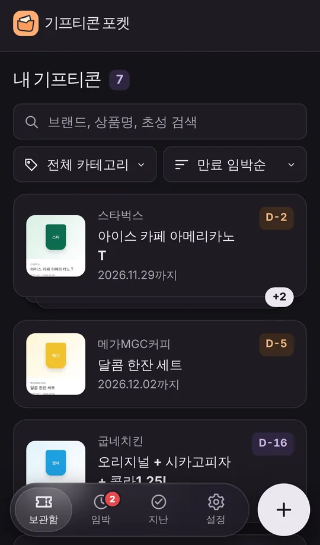&nbsp;
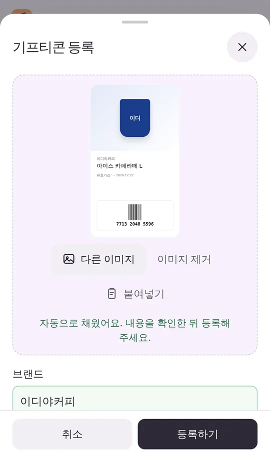&nbsp;
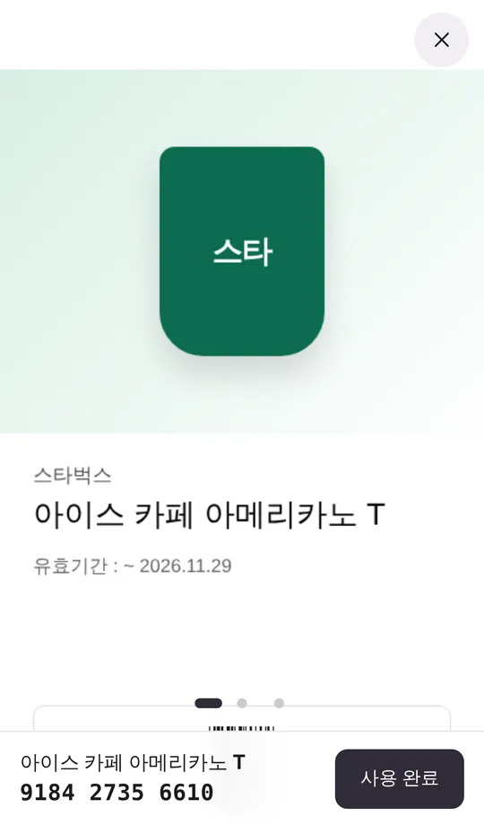&nbsp;
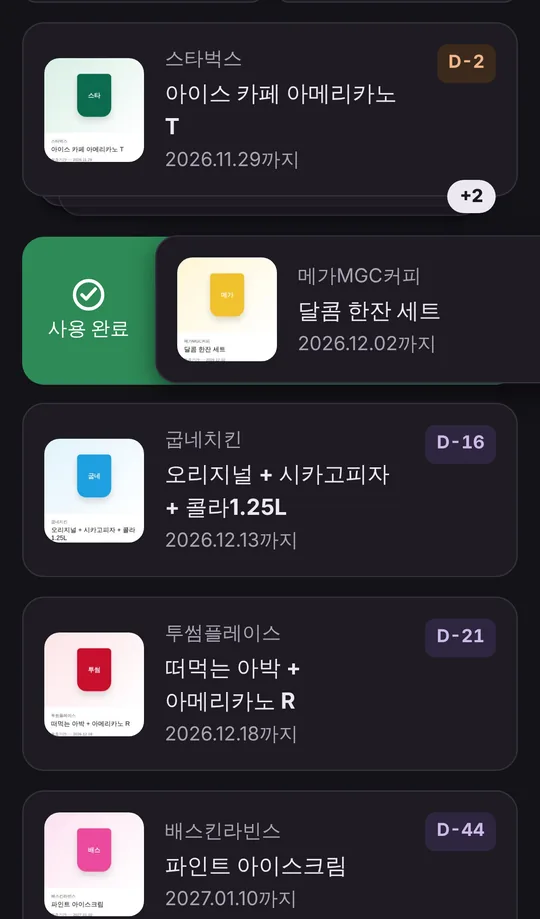

</div>

---

## ✨ 한눈에 보기

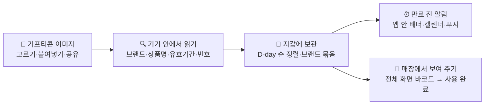

| | 기능 | 한 줄 설명 |
|:-:|---|---|
| 📸 | **이미지로 자동 등록** | 이미지를 고르면 입력란이 채워져요. 여러 장은 한 번에, 카카오톡 이미지는 복사→붙여넣기로 |
| 🔢 | **바코드로 번호 읽기** | 바코드에서 쿠폰 번호를 바로 읽어요(iPhone 포함). 글자 인식보다 정확해요 |
| ⏰ | **만료 임박 챙기기** | 3일 안에 만료되면 맨 위에 알려 주고, 캘린더(.ics)로 받으면 앱을 안 열어도 알림이 와요 |
| 🏪 | **매장에서 보여 주기** | 흰 배경 전체 화면 + 화면 꺼짐 방지. 같은 브랜드 여러 장은 옆으로 넘기며 연달아 사용 |
| 👆 | **휴대폰 앱 같은 조작** | 밀어서 사용 완료·삭제, 길게 눌러 여러 개 선택, 유리 탭 바, 모든 동작 실행 취소 |
| 💳 | **금액권 잔액** | 쓴 금액만큼 차감하고, 0원이 되면 자동으로 사용 완료 |
| 🔎 | **찾기** | 브랜드·상품명·메모·번호·초성(ㅅㅌㅂㅅ) 검색, 카테고리·정렬 |
| 🌙 | **테마** | 기기 설정 / 밝게 / 어둡게 |
| 📴 | **오프라인** | 한 번 열면 인터넷 없이도 보고, 쓰고, 이미지도 읽어요 |
| 💾 | **백업** | 이미지까지 담은 백업 파일로 다른 기기에 옮기기 |

## 👆 제스처 한눈에

| 동작 | 결과 |
|---|---|
| 카드를 **오른쪽으로 밀기** | `사용 완료` 버튼이 나타나요 → 눌러야 처리 |
| 카드를 **왼쪽으로 밀기** | `삭제` 버튼이 나타나요 → 눌러야 처리 |
| 카드를 **길게 누르기** (PC: 오른쪽 클릭) | 선택 모드 → 여러 장 한 번에 사용 완료·삭제 |
| **겹친 카드(+2)** 누르기 | 같은 브랜드 쿠폰 펼치기 |
| 쿠폰 보여주기·상세에서 **옆으로 밀기** (PC: ←/→) | 다음·이전 쿠폰 |
| 시트를 **아래로 끌기** | 닫기 |
| 탭 바의 **선택 표시 끌기** | 다른 탭으로 이동 |

> 모든 사용 완료·삭제는 아래 알림의 **실행 취소**로 되돌릴 수 있어요.

## 📱 화면

| 같은 브랜드 묶음 | 여러 개 선택 | 상세 | 설정 |
|:-:|:-:|:-:|:-:|
| 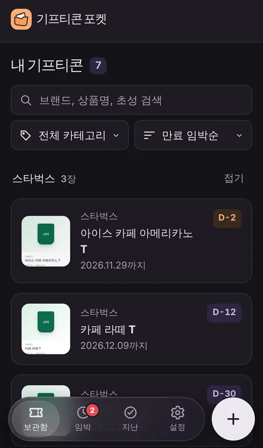 | 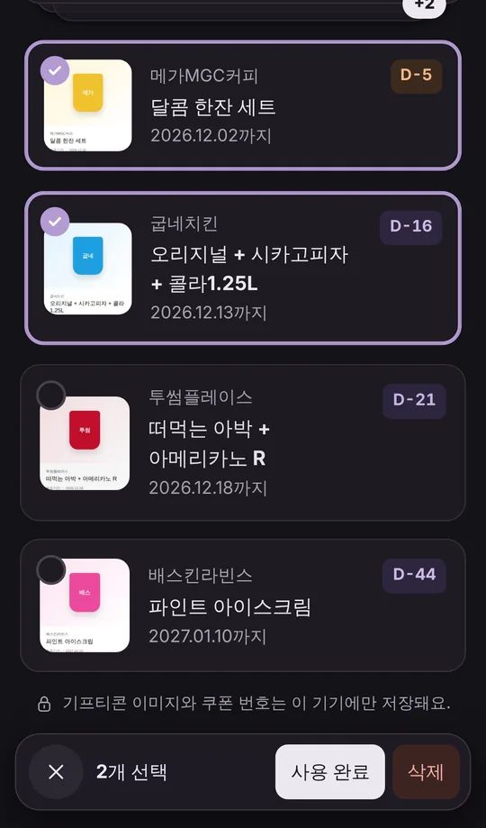 | 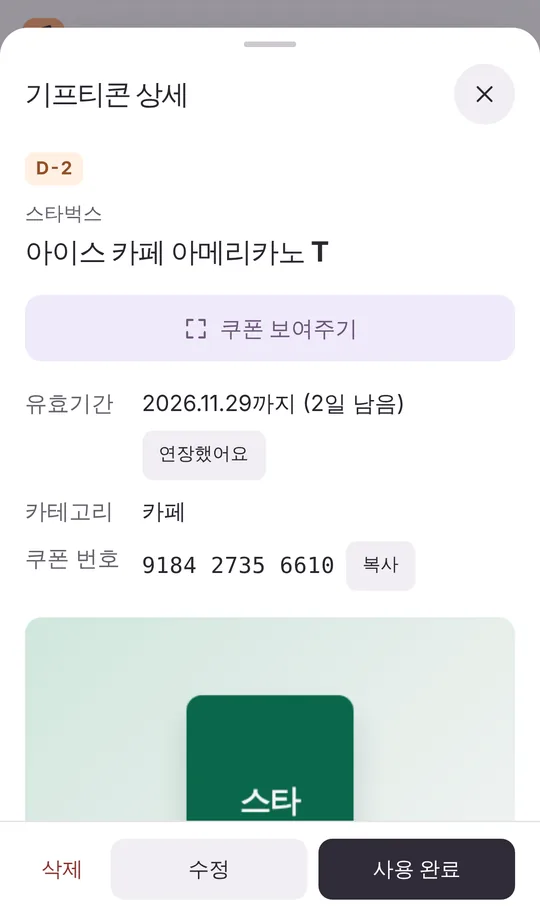 | 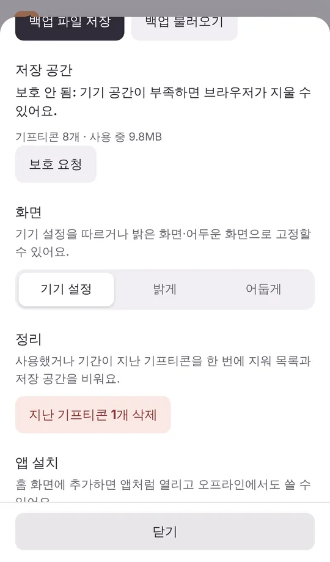 |

<details>
<summary>🖥️ PC 화면 보기</summary>

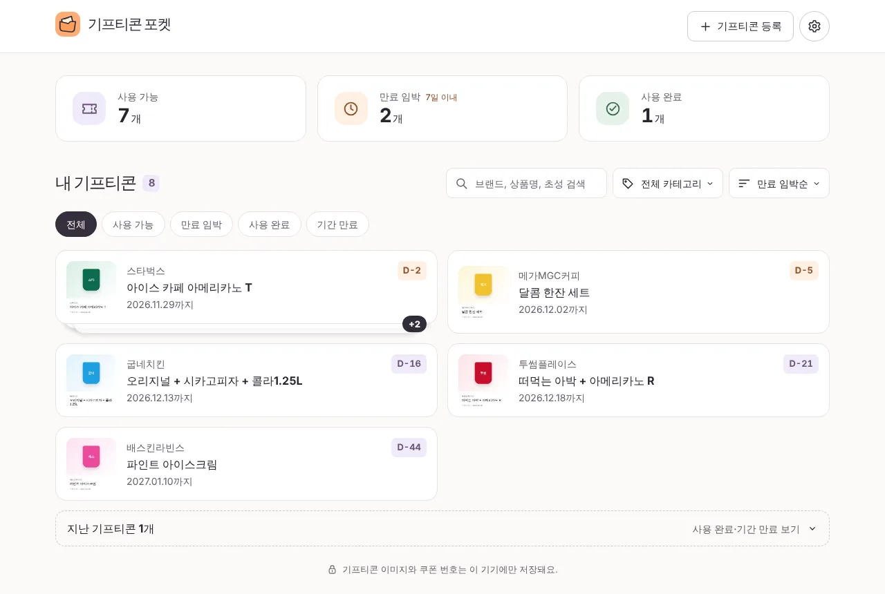

PC에서는 `/`로 검색, `n`으로 등록할 수 있어요.
</details>

<sub>화면은 실제 앱을 데모 쿠폰으로 캡처한 것이에요. `npm run screenshots`로 다시 만들 수 있어요.</sub>

## 🔍 이미지는 이렇게 읽어요

모든 과정은 **기기 안에서** 일어나요. 이미지는 어디에도 전송되지 않아요.

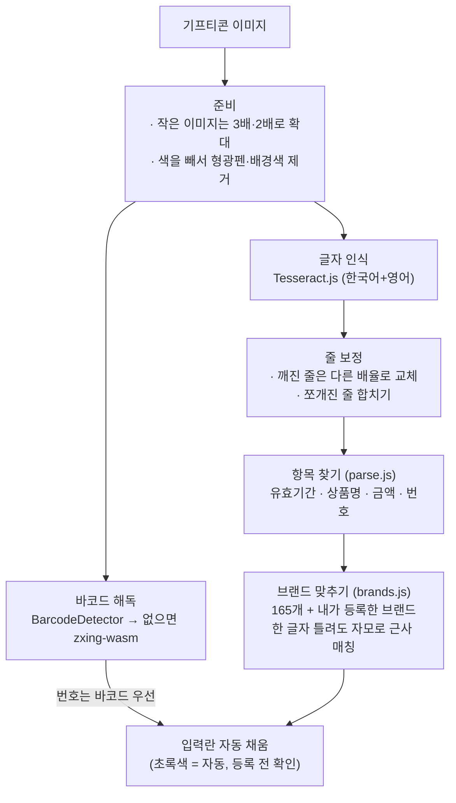

## 🧰 기술 스택

**앱** — 프레임워크·번들러 없이 브라우저 표준만 사용해요.


·color--mix·backdrop--filter-1572B6?logo=css3&logoColor=white)


**이미지 읽기**


**배포·알림·품질**


## 🏗️ 구조

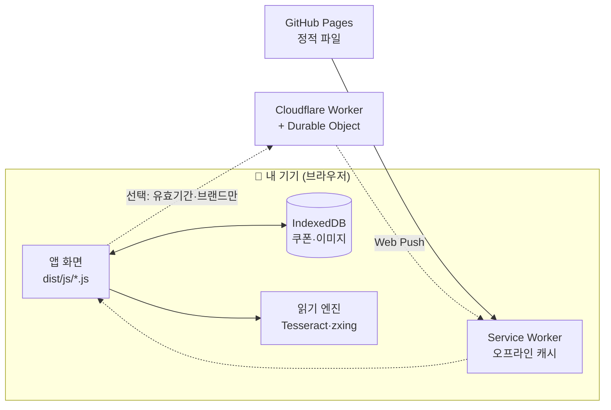

- **GitHub Pages 버전**: 서버 없이 동작해요. 만료 알림은 앱 안 배너와 캘린더 파일로 받아요.
- **Cloudflare 버전**(선택): 만료 3일 전·당일 오전 9시에 백그라운드 푸시를 보내요. 이때만 유효기간·브랜드·상품명을 서버에 보관하고, 쿠폰 번호와 이미지는 보내지 않아요.

## 🔒 개인정보

| | |
|---|---|
| 🖼️ 이미지·쿠폰 번호 | 기기 밖으로 나가지 않아요. 이미지 읽기도 기기 안에서 해요 |
| 🔄 동기화 | 하지 않아요. 브라우저 데이터를 지우면 쿠폰도 지워지니 **백업 파일**을 저장해 두세요 |
| 🍎 iPhone | Safari는 오래 안 쓰면 사이트 데이터를 지울 수 있어요. **홈 화면에 추가**해서 쓰세요 |
| 💬 카카오톡 | 카카오톡 안의 브라우저는 저장 공간이 따로라서, 다른 브라우저로 열도록 안내해요 |

## 📲 설치

[앱](https://hyunim.github.io/gifticon-pocket/)을 열고 상단의 **앱 설치**를 누르세요. iPhone은 Safari 공유 메뉴 → **홈 화면에 추가**. Android는 설치 후 카카오톡 공유 메뉴에서 바로 보낼 수 있어요.

## 🛠️ 개발

```sh
npm install          # 개발 도구 설치
npm run build        # 오프라인 파일 목록 생성
npx wrangler dev     # 또는: python3 -m http.server 8787 --directory dist
```

| 명령 | 하는 일 |
|---|---|
| `npm test` | 단위 테스트 62개 — OCR 결과 19종 인식, 날짜·알림 계산, 백업, Web Push 암호화(RFC 8291 예제 값), 알림 서버 |
| `npm run build` | `dist/sw-manifest.js`(오프라인 파일 목록·무결성 해시) 생성 |
| `npm run vendor` | Tesseract.js·zxing-wasm을 `dist/vendor/`로 복사 (버전을 바꾼 뒤) |
| `npm run screenshots` | README 화면 캡처 다시 만들기 (Playwright 필요) |
| `npm run deploy` | GitHub Pages 수동 배포 |
| `npm run deploy:worker` | Cloudflare 배포 (푸시 알림 포함) |

<details>
<summary>📁 폴더 구조</summary>

```
dist/                  배포되는 앱 그대로 (빌드 단계 없음)
├─ index.html · style.css · sw.js · manifest.webmanifest
├─ js/
│  ├─ app.js           화면·제스처·목록
│  ├─ parse.js         OCR 글자 → 항목 (유효기간·번호·상품명)
│  ├─ brands.js        브랜드 165개·근사 매칭·카테고리
│  ├─ ocr.js           Tesseract·바코드 읽기, 2배율 보정
│  ├─ images.js        축소·확대·색 제거·썸네일
│  ├─ db.js            IndexedDB (Safari Blob 안전 저장)
│  ├─ coupon.js        상태·D-day·정렬·검색
│  ├─ calendar.js      .ics 캘린더 파일
│  ├─ backup.js · reminders.js · push.js · install.js · dom.js
└─ vendor/             Tesseract.js 7 · zxing-wasm (처음 쓸 때 내려받아 캐시)
worker/                Cloudflare Worker + Durable Object (Web Push)
scripts/               배포·오프라인 목록·엔진 복사·화면 캡처
test/                  node:test 단위 테스트
docs/screenshots/      README 화면
```
</details>

## 🚀 배포

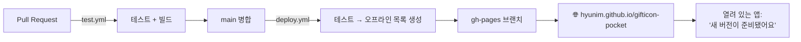

`main`에 병합하면 자동으로 배포돼요. 테스트가 실패하면 배포하지 않고, 진행 상황은 **Actions** 탭에서 볼 수 있어요.

<details>
<summary>☁️ Cloudflare 배포 (백그라운드 푸시 알림)</summary>

```sh
npx wrangler login
npm run deploy:worker
```

`dist`는 Workers Static Assets로, `worker/index.js`는 Worker로 배포되고 `PushReminders` Durable Object(무료 플랜의 SQLite 저장소)를 만들어요. VAPID 키는 처음 요청할 때 자동으로 만들어 보관해요. 직접 관리하려면 `VAPID_PUBLIC_KEY`·`VAPID_PRIVATE_KEY`(base64url) 시크릿과 `VAPID_SUBJECT`(`mailto:`/`https:`) 변수를 설정하세요. 키를 바꾸면 기존 구독자는 알림을 다시 켜야 해요.
</details>

<details>
<summary>🔄 이미지 읽기 엔진 업데이트</summary>

`package.json`의 `tesseract.js`·`tesseract.js-core`·`@tesseract.js-data/*`·`zxing-wasm` 버전을 바꾼 뒤:

```sh
npm install
npm run vendor
```

엔진 폴더 이름에 버전이 들어가서, 바뀌면 사용자 기기의 캐시도 자동으로 새로 받아요.
</details>
